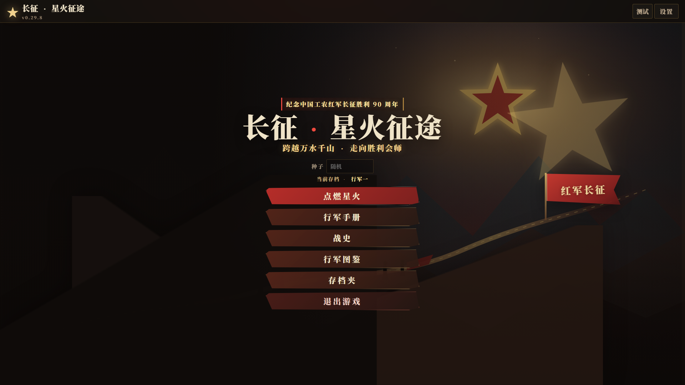
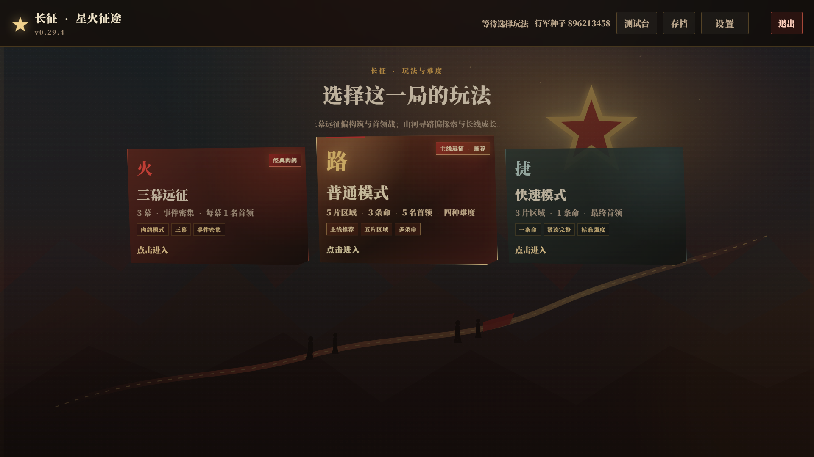
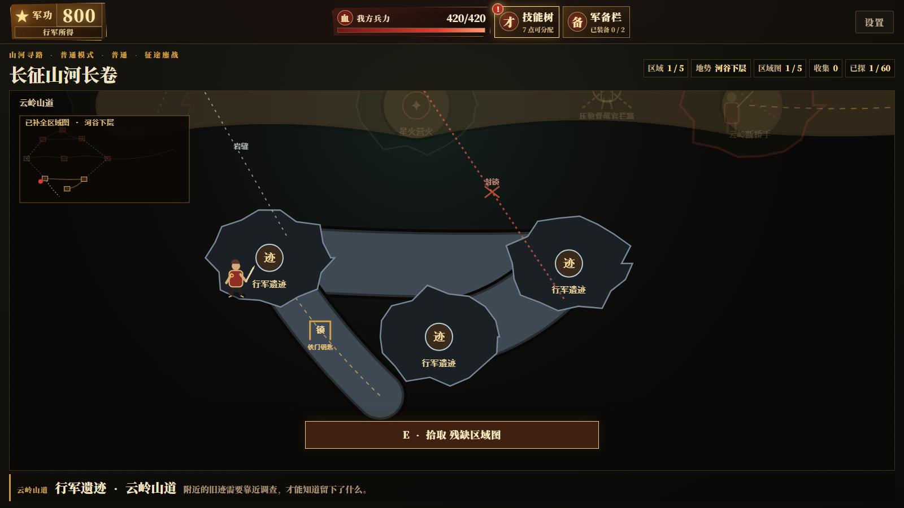

# Spark Trail: The Long March

## 长征·星火征途

A real-time action roguelike inspired by the Long March, built with JavaScript and Canvas.

Current version: **v0.32.0**

Platform: **Windows 10/11**

Status: **Playable course-practice prototype**







## Highlights

- Real-time sword combat with perfect parries, blade clashes, dodges, Mikiri-style counters, jumping, shooting, posture breaks, and executions.
- Automatic visual quality that adapts to device capability, with high, balanced, and power-saving presets.
- Free-form talent graph with prerequisite links, plus a one-page compact shop that avoids wheel scrolling.
- Elites and bosses with distinct movesets, feints, repositioning, delayed attacks, fast combos, and phase transitions.
- Two main play structures:
  - **Three-Act Expedition**: classic roguelike progression, events, elites, and one boss per act.
  - **Normal Mode**: multi-life exploration, five regions, multiple bosses, campfires, puzzles, NPC quests, equipment upgrades, and four difficulty levels.
- Separate per-save run history, history codex, item details, and independent audio/window settings.
- Keyboard and controller support with fully rebindable controls.
- Local save service with no console window and Windows 11 compatibility manifest.

## Quick Start

Double-click:

```text
启动图形版.bat
```

This starts the local save service and opens the game in Edge or the default browser.

The save service can also be started manually:

```powershell
.\tools\LongMarchServer.exe --root . --no-browser
```

Then open:

```text
http://127.0.0.1:28765/
```

For a browser-only run without the local save service, open `启动游戏.html`. In that mode, saves use browser-local storage instead of the independent save folder.

## Controls

| Action | Keyboard | Controller |
|---|---|---|
| Move | WASD | Left stick |
| Attack / charged thrust | Left mouse / J | RB |
| Guard / parry | F | LB |
| Dodge | Shift | B |
| Jump | Space | A |
| Shoot | R | Y |
| Execute | X | X |
| Heal | Q | D-pad down |
| Quick item | G | D-pad up |
| Interact | F | X |
| Pause | Esc / P | Menu |
| Buffs | B | View / Share |

All bindings can be changed in Settings.

## Save Data

The installed/local-service version stores saves in:

```text
%USERPROFILE%\Documents\长征·星火征途存档
```

Each save slot has its own subfolder and separate run history.

The browser-only mode stores progress in the current browser profile and does not share saves with the local-service version.

## Development

### Repository layout

```text
web/                         Game client, Canvas rendering, UI, and assets
tools/LongMarchServer.cs     Local static server and save API
tools/LongMarchServer.exe    Prebuilt no-console service
docs/                        Design, sources, technical notes, and screenshots
启动图形版.bat                Local-service launcher
启动游戏.html                 Browser-only launcher
```

### Requirements

- Windows 10/11
- Edge or Chrome
- Node.js for JavaScript syntax checks
- .NET Framework 4.x for compiling the save service

### Edit and test

1. Start the local service and open the game.
2. Edit files under `web/`.
3. Refresh the game window.
4. Run:
   ```powershell
   node --check web/game.js
   ```
5. Rebuild the save service if `tools/LongMarchServer.cs` changed:
   ```powershell
   powershell -NoProfile -ExecutionPolicy Bypass -File .\tools\build-server.ps1
   ```

### Important modules

- `web/game.js`: combat, enemy AI, maps, progression, UI, saves, and Canvas rendering.
- `web/style.css`: responsive UI, HUD, menus, codex, settings, and visual effects.
- `web/index.html`: game screens and overlays.
- `tools/LongMarchServer.cs`: static file serving, per-slot saves, history, settings, and window launch behavior.

## Documentation

- [Game design](docs/游戏设计文档.md)
- [Technical notes](docs/技术方案.md)
- [Project description](docs/作品说明.md)
- [Presentation guide](docs/演示指南.md)
- [Historical sources](docs/历史资料来源.md)
- [Asset sources](docs/图片素材来源.md)
- [AI usage disclosure](docs/AI使用说明.md)
- [Contributing](CONTRIBUTING.md)
- [Changelog](CHANGELOG.md)

## Notice

This is an unofficial, non-commercial course-practice project. Gameplay, characters, encounters, and random events are fictional interpretations and should not be treated as historical fact. Historical references are documented separately. Maps are exploration illustrations and are not intended as boundary references.

See [NOTICE.md](NOTICE.md) for details.
